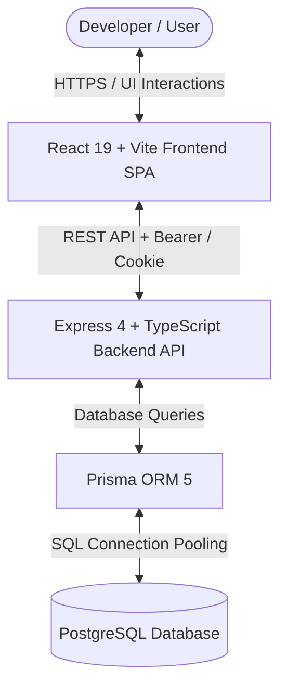

# DevFlow Architecture Documentation

## 1. System Overview

DevFlow is an enterprise-grade developer productivity platform designed for engineering teams and solo builders to manage software projects, Kanban tasks, technical notes, and delivery metrics in one unified workspace.

---

## 2. Frontend Architecture

### Technology Stack
- **Framework:** React 19 + TypeScript
- **Bundler & Tooling:** Vite 6 with `@tailwindcss/vite`
- **Routing:** React Router v7 (`BrowserRouter`, `Routes`, `Route`, `Navigate`)
- **State & Server Cache:** TanStack Query (`@tanstack/react-query` v5)
- **Styling:** Tailwind CSS v4 with dark mode tokens, glassmorphism (`backdrop-filter`), glowing borders, and Inter / JetBrains Mono typography.
- **Icons:** Lucide React

### Directory Structure & Responsibilities
- `src/components/ui/`: Reusable primitive components (`Button`, `Badge`, `Modal`, `Input`, `Textarea`, `Select`, `Card`, `EmptyState`).
- `src/features/auth/`: Authentication provider, session lifecycle, and `ProtectedRoute` guard.
- `src/layouts/`: `DashboardLayout`, `Sidebar` (collapsible navigation, live status), `Header` (search, system health indicator, user profile).
- `src/pages/`:
  - `auth/`: `LoginPage`, `RegisterPage`
  - `dashboard/`: `DashboardPage` (KPI metrics, active projects, activity feed)
  - `projects/`: `ProjectsPage`, `ProjectDetailPage` (Kanban, Task Table, Notes, Team Members)
  - `kanban/`: `KanbanBoardPage` (Interactive 4-column drag-and-drop board)
  - `notes/`: `NotesPage` (Markdown-friendly technical notes catalog)
  - `analytics/`: `AnalyticsPage` (Quantitative KPI progress bars, status breakdown, audit trail)
- `src/lib/api.ts`: Centralized fetch wrapper with automatic token management, parameter serialization, and error normalization.

---

## 3. Backend Architecture

### Technology Stack
- **Runtime:** Node.js (v22 / v24) ESM
- **Framework:** Express 4 with TypeScript
- **Validation:** Zod schemas for runtime request body, query, and params validation
- **Database Access:** Prisma ORM 5 with connection resilience
- **Authentication:** JSON Web Tokens (`jsonwebtoken`) + HTTP-only cookies
- **Hashing:** Bcrypt (`bcryptjs`) with 10 salt rounds
- **Security:** Helmet headers, CORS origin whitelist, Express rate-limiter

### Layered Structure
1. **Server Bootstrap (`src/server.ts`):** Environment boot, port listening, database health check, graceful shutdown handlers (`SIGTERM`, `SIGINT`).
2. **Application Configuration (`src/app.ts`):** Security middlewares, CORS, parsers, rate limiting, route mounting, 404, centralized error handler.
3. **Route Controllers (`src/routes/`):**
   - `health.routes.ts`: Health check reporting dependency availability honestly.
   - `auth.routes.ts`: Registration, login, logout, me.
   - `project.routes.ts`: Project management and membership with Broken Object-Level Authorization (BOLA) safeguards.
   - `task.routes.ts`: Task tracking, Kanban status transitions, comments discussion thread.
   - `note.routes.ts`: Technical runbooks and documentation.
   - `analytics.routes.ts`: Dashboard aggregation directly from database queries.
4. **Middlewares (`src/middleware/`):** `auth.ts`, `validate.ts`, `errorHandler.ts`.
5. **Data Access (`src/utils/prisma.ts`):** Prisma client singleton and database ping checker.

---

## 4. Security Model

1. **Broken Object-Level Authorization (BOLA) Prevention:** Every project, task, and note endpoint validates that the authenticated user is either the project owner or an active member before allowing read, write, or delete actions. Manipulating UUIDs across different projects will return HTTP 403 Forbidden.
2. **Password Storage:** Plain-text passwords are never stored. Passwords are hashed using bcrypt with salt factor 10. Minimum length enforced is 8 characters.
3. **Token Handling:** JWT tokens are returned in the response payload for header authorization (`Authorization: Bearer <token>`) and simultaneously issued as an HTTP-only cookie (`auth_token`) with `sameSite` protection.
4. **Rate Limiting:** Authentication routes are protected with `express-rate-limit` to prevent brute-force attacks.
5. **Secret Protection:** Secrets, passwords, and tokens are strictly excluded from version control via `.gitignore`. `.env.example` provides sanitized placeholders only.
